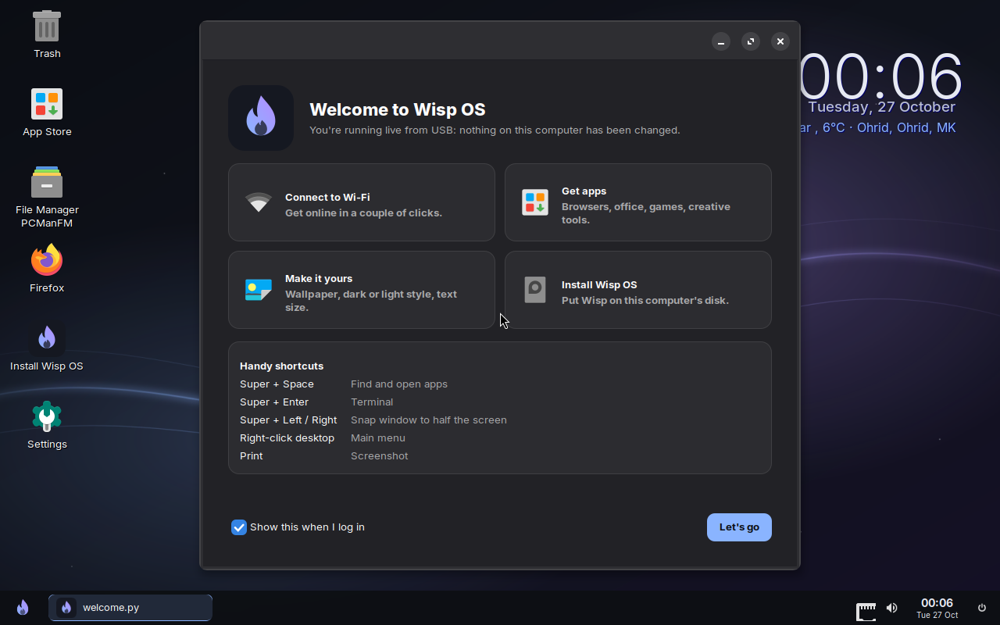
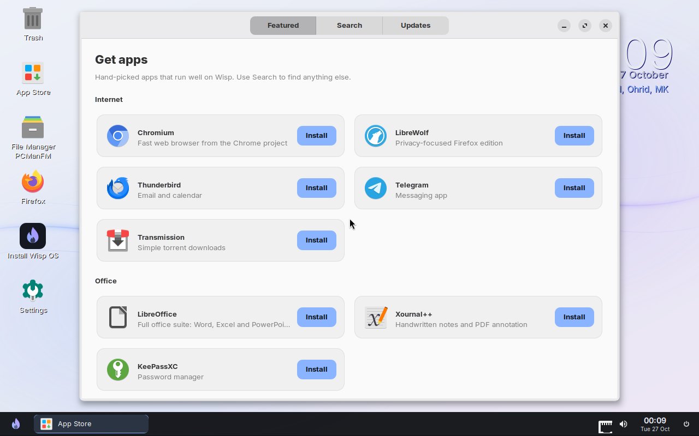
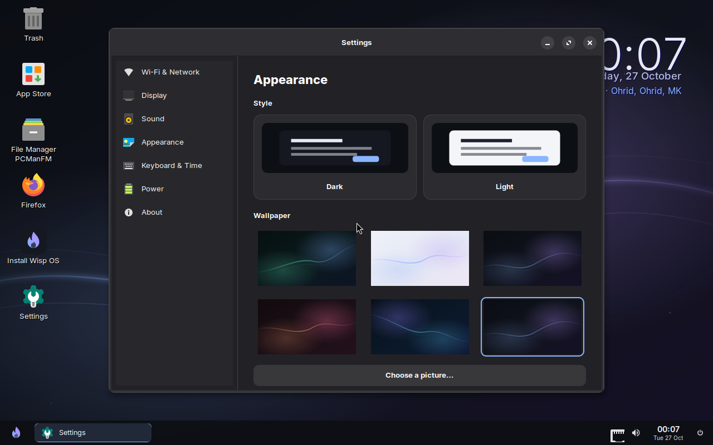
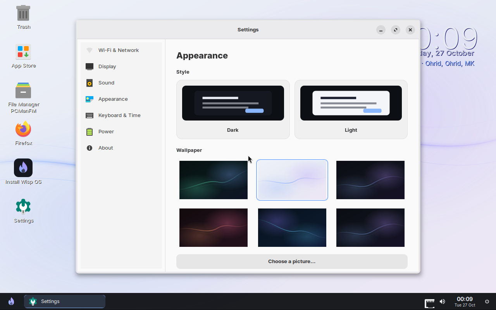

# Wisp OS

A tiny, good-looking Linux desktop for old and low-RAM PCs (1 GB is enough).

- **Base:** Alpine Linux 3.24 (musl, OpenRC, no systemd), Linux LTS kernel
- **Desktop:** Openbox (windows) + tint2 (taskbar) + rofi (app launcher) + picom (rounded corners and shadows) + dunst (notifications) + PCManFM desktop icons + a clock and weather widget
- **Look:** the "Wisp Night" dark theme, plus a **light theme** you can switch to live. Five wallpapers, Inter font, Papirus icons, adw-gtk3 for apps, a themed boot menu and a logo splash instead of scrolling text
- **Wisp apps (written for this distro):**
  - **Settings** (14 pages): Wi-Fi (scan, connect, hidden networks, airplane mode, IP address), display (resolution, text size, brightness, night light), sound (output and microphone choice, per-app volume), appearance (dark/light, 7 accent colours, wallpaper, pointer size, effects), desktop & taskbar (top or bottom, 12/24-hour clock, desktop clock and weather), notifications (do not disturb, position), mouse & touchpad (speed, natural scrolling, tap to click, left-handed), keyboard (two layouts with Alt+Shift, repeat speed), date & time (time zone, automatic time), default apps, power, storage (folder sizes, empty trash, clear cache), updates (check, install, daily notification), about (system info, rename computer)
  - **Task Manager**: apps and background processes with friendly names and icons, CPU and memory per app, end or force-quit, live CPU/memory graphs, disk and compressed-memory use
  - **App Store**: hand-picked apps in categories (Chromium, LibreOffice, GIMP, VLC, OBS, Telegram, games...), search across all 20,000+ Alpine packages, one-click install/remove, system updates
  - **Welcome**: first-login screen with Wi-Fi, apps, personalise and install shortcuts
- **Included apps:** Firefox, Files, Terminal, Text Editor, Media Player (mpv: video and music), Document Viewer (PDF), AbiWord (documents), Gnumeric (spreadsheets), Drawing, Calculator, Image Viewer, Archives, Screenshot, Task Manager, Sound Mixer
- **Low-RAM tricks:** zram compressed swap (half of RAM, zstd), no display manager (auto-login on tty1, then `startx`), no indexers or background updaters, the live system runs from a compressed squashfs, and Firefox is set to 2 content processes and unloads tabs when memory is low. Wisp's own apps are Python and only use memory while they're open.






## Memory use (measured)

Idle desktop in a 1 GB virtual machine, right after boot, with desktop icons, clock widget, Wi-Fi applet, audio server, compositor and panel running:

| What | RAM |
|---|---|
| `free -m` "used" (everything, including the kernel) | **~167 MB** |
| Available for apps | **~643 MB** of 964 MB |

Biggest users (private memory, live session in a VM): Xorg (29 MB), Wi-Fi icon (19 MB), desktop icons (17 MB), tint2 (15 MB), NetworkManager (8 MB), clock widget (6 MB), openbox (5 MB), sound (7 MB for PipeWire and WirePlumber).

Memory savers: without a real GPU driver, Xorg skips glamor and server-side GLX (they would load the ~40 MB software OpenGL stack; see `/etc/local.d/wisp-gpu.start`); WirePlumber's camera monitors are off; the accessibility bus isn't started; unused kernel modules (KVM, PC speaker) are blacklisted; Firefox doesn't pre-launch a spare content process. `earlyoom` closes the biggest browser tab or app before a 1 GB machine can freeze.
Real hardware with an Intel GPU should come in a bit lower, because the VM renders graphics in software.
Getting to 100 MB total would mean dropping the Wi-Fi applet, the audio server and the compositor. That works, but it stops being a comfortable desktop.

## Build (macOS or Linux, needs Docker)

```bash
./build.sh
```

The first build downloads about 800 MB of packages and takes roughly 30-40 minutes on an Apple Silicon Mac (x86 is emulated). Packages are cached in `.cache/`, so rebuilds take about 10 minutes. `SKIP_ROOTFS=1 ./build.sh` only re-packs the ISO.

The output is `out/wisp-os-0.1-x86_64.iso`: a hybrid BIOS + UEFI image that boots from a USB stick or a DVD.

The build needs the private signing key at `~/.config/wisp-keys/wisp-os.rsa` (or set `WISP_KEYS` to its folder). See below.

## Updates: how installed Wisp systems get your changes

Everything Wisp adds to Alpine (`overlay/`, the artwork, and the list in `packages.txt`) is packaged as **`wisp-desktop`**, a signed Alpine package. The ISO is built from that same package, and every Wisp system checks the Wisp package repository alongside Alpine's.

**To ship an update:** commit and push to `main`. GitHub Actions (`.github/workflows/publish.yml`) then:
1. builds `wisp-desktop` with version `0.1.<number of commits>` and signs it,
2. publishes it with the landing page on GitHub Pages:
   - https://vetonfetai.github.io/wispos/ is the landing page
   - https://vetonfetai.github.io/wispos/repo/ is the package repository

Installed systems then pick it up from Settings > Updates or App Store > Updates (and a daily "Updates available" notification), together with Alpine's own updates.

What an update does on each computer:
- replaces Wisp's apps, themes, artwork and system files, and installs any new packages added to `packages.txt` (they're dependencies of `wisp-desktop`)
- runs `/usr/lib/wisp/system-fixup` (services, launcher names, files that belong to other Alpine packages such as `/etc/inittab`)
- at each user's next login, refreshes Wisp's desktop configs from `/etc/skel` (old copies go to `~/.config/wisp/backup-before-update`), re-applies their Settings choices on top, and shows "Wisp OS was updated"

Files that should only be set on a fresh install (hostname, hosts) live in `image/`, not in the package.

**One-time setup on GitHub** (already done if the Actions tab shows green runs):
1. Settings > Secrets and variables > Actions > New repository secret: name `WISP_SIGNING_KEY`, value = the whole content of `~/.config/wisp-keys/wisp-os.rsa`.
2. Settings > Pages > Build and deployment > Source: **GitHub Actions**.

**Keep a backup of `wisp-os.rsa`** somewhere safe (a password manager works). Every Wisp system trusts only that key. If it's lost, existing installs can't verify new updates; if it leaks, someone else could sign updates. It's never committed (see `.gitignore`); only the public half `keys/wisp-os.rsa.pub` is in the repo.

To build just the package locally: `scripts/build-package.sh ~/.config/wisp-keys out/repo`.

## Try it without touching your computer

On your Mac, in a virtual machine:

```bash
brew install qemu
./test/run-vm.sh
```

On the ThinkPad, run it **live from USB**. The live system runs entirely in RAM, so your disk is not changed.

1. Write the ISO to a USB stick (all data on the stick is erased) with [balenaEtcher](https://etcher.balena.io), or on macOS:
   `diskutil list` (find the stick, e.g. `/dev/disk4`), then
   `diskutil unmountDisk /dev/disk4 && sudo dd if=out/wisp-os-0.1-x86_64.iso of=/dev/rdisk4 bs=4m && sync`
2. On the ThinkPad: BIOS (F1 at power-on) → **Security → Secure Boot → Disabled**.
3. Power on, press **F12**, and pick the USB stick.
4. Choose **Wisp OS (live)**. If the screen stays black, reboot and choose **safe graphics**.

The live user is `wisp` with password `wisp`. Live mode never writes to the internal disk.

## Install to disk

From the live session: double-click **Install Wisp OS** on the desktop (or find it with Super+Space), then follow the prompts. It erases the whole disk you pick, creates a GPT layout that boots on both BIOS and UEFI, asks for a computer name and password, and asks whether to log in automatically.

## Known limitations (v0.1)

- **Secure Boot must be off.** The bootloader is not signed.
- **Apps installed in live mode** are kept in RAM and disappear on restart; install Wisp OS to keep them. The App Store needs an internet connection.
- **Weather** comes from wttr.in and guesses your city from your IP address.
- **Tested in VMs only so far:** live boot (BIOS and UEFI), installing to a disk, and booting the installed system (BIOS and UEFI) all work. Real ThinkPad hardware (Wi-Fi, suspend, brightness keys) is still untested.
- Firefox is the heaviest part. Expect about 300-400 MB of RAM with a few tabs open.
- x86_64 only (no 32-bit).

## Keyboard shortcuts

| Keys | Action |
|---|---|
| Super+Space / Super+D | App launcher |
| Super+Enter | Terminal |
| Super+E / Super+B | Files / Browser |
| Super+Left / Right / Up | Snap left / Snap right / Maximize |
| Super+Q or Alt+F4 | Close window |
| Super+I | Settings |
| Super+Tab / Alt+Tab | Window switcher |
| Super+L | Lock |
| Super+X | Power menu |
| Print / Shift+Print | Screenshot (full screen / area) to ~/Pictures |
| Ctrl+Alt+Delete | Task Manager |

Right-click the desktop for the main menu (it includes **Toggle Effects**, which turns off rounded corners and shadows to make very old machines even lighter).

## Layout of this repo

```
build.sh                      host entry point (runs Docker)
packages.txt                  everything that goes into the OS (dependencies of wisp-desktop)
VERSION                       base version; packages are VERSION.<commit count>
pkg/wisp-desktop/             APKBUILD and install hooks for the wisp-desktop package
keys/wisp-os.rsa.pub          public key that installed systems use to verify updates
scripts/build-package.sh      builds and signs wisp-desktop + repository index
scripts/build-in-container.sh builds rootfs (from wisp-desktop) → squashfs → ISO
.github/workflows/publish.yml publishes package + landing page to GitHub Pages on every push
image/                        files only for a fresh install (hostname, hosts)
site/                         landing page
scripts/live-init             live-boot initramfs (finds USB, overlay in RAM)
scripts/grub.cfg              boot menu
overlay/                      the contents of the wisp-desktop package
  etc/skel/.config/...        default desktop config (openbox, tint2, rofi, picom, dunst, gtk)
  usr/share/themes/Wisp/      Openbox window theme
  usr/lib/wisp/               Settings, App Store, Welcome, Task Manager and the session starter (Python + GTK3)
  usr/lib/wisp/system-fixup   system tweaks re-applied after every install/update
  usr/share/wisp/system/      files owned by other Alpine packages, copied over them by system-fixup
  usr/bin/wisp-*              installer, power menu, volume, screenshot, effects, weather, update check
  usr/libexec/wisp/wisp-root  the only admin helper the apps may run (installs, updates, time zone)
art/                          wallpapers, logo, boot splash (SVG, rendered at build time)
test/run-vm.sh                QEMU test runner
```
